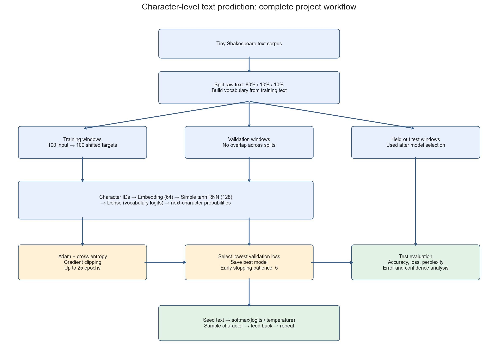
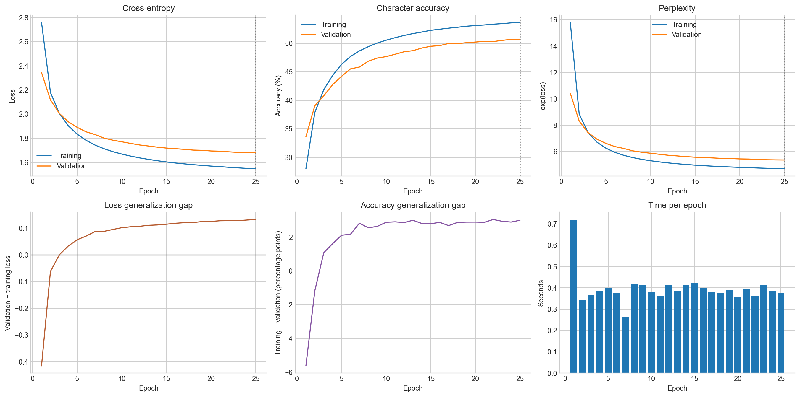

# Character-Level Text Prediction with a Simple RNN

CSE 457 — Deep Learning end-semester lab project. Predict the next character in
Tiny Shakespeare and generate short text using a vanilla recurrent neural network.

## View the completed project

- [Executed Jupyter notebook](Shakespeare_SimpleRNN.ipynb)
- [HTML notebook export](Shakespeare_SimpleRNN.html): download and open in a browser
- [Generated samples](outputs/generated_samples.txt)
- [Standalone figures](outputs/figures)

The HTML includes all graphs inline. No Python installation is needed to view it.



## Model and methodology

Character IDs → Embedding (64) → Simple tanh RNN (128) → Dense → Softmax.
PyTorch `nn.RNN` implements the simple recurrent architecture; no LSTM or GRU is used.
Cross-entropy consumes logits during training and applies log-softmax internally.

- Split raw text into contiguous 80% training, 10% validation, 10% test portions
  **before** constructing windows, avoiding overlap between splits.
- Learn vocabulary from training text, with an unknown-character fallback.
- Use 100-character windows with a next-character target at every position.
- Adam, learning rate 0.002, batch size 128, gradient clipping at 1.0.
- Train up to 25 epochs; early stopping patience 5; select lowest validation loss.
- Evaluate complete test windows only; discard the final incomplete window.
- Generate by sampling softmax probabilities at temperatures 0.5, 0.8, and 1.2.

## Recorded results

Training ran locally on an NVIDIA GeForce RTX 5070 Laptop GPU (8 GB), with
PyTorch 2.8.0 + CUDA 12.8 and Python 3.13.9. Best checkpoint: epoch 25.

| Metric | Held-out test result |
|---|---:|
| Next-character accuracy | 46.68% |
| Most-common-character baseline accuracy | 14.90% |
| Cross-entropy loss | 1.8533 |
| Perplexity | 6.38 |



The notebook contains 12 rendered figures, including multi-panel charts: dataset
distribution, learning curves, perplexity, generalization gaps, timing, baseline and
top-k comparisons, confusion matrix, per-character precision/recall, common errors,
calibration, context-position accuracy, prediction heatmap, temperature effects,
and generated-text diversity.

Accuracy is measured with teacher forcing. Free-running generation can compound
errors. Samples show dialogue-like patterns but contain repetition, invented words,
and weak long-range coherence. Diversity scores are not measures of literary quality.
Results are from one training run; exact reproducibility can vary with hardware.

## Setup and run (Windows PowerShell)

Use Python 3.13. Create a fresh environment in the cloned repository:

```powershell
python -m venv .venv
.\.venv\Scripts\python.exe -m pip install -r requirements.txt
```

For an NVIDIA GPU compatible with CUDA 12.8:

```powershell
.\.venv\Scripts\python.exe -m pip install torch==2.8.0 --index-url https://download.pytorch.org/whl/cu128
```

For CPU-only training, use this command instead:

```powershell
.\.venv\Scripts\python.exe -m pip install torch==2.8.0 --index-url https://download.pytorch.org/whl/cpu
```

Register the kernel and open the notebook:

```powershell
.\.venv\Scripts\python.exe -m ipykernel install --prefix .venv --name shakespeare-rnn --display-name "Shakespeare RNN (local GPU)"
.\open_notebook.ps1
```

Select the **Shakespeare RNN (local GPU)** kernel. The code automatically selects
CUDA when available and otherwise uses the CPU, regardless of the kernel's name.
Run all cells to train, evaluate, generate, and reproduce the visualizations.
The bundled corpus allows offline use after dependencies are installed.

## Scripts and artifacts

| File | Purpose |
|---|---|
| `train_project.py` | Training, evaluation, basic plots, generation |
| `visualizations.py` | Extended analysis and flowchart source |
| `build_notebook.py` | Rebuild base notebook; clears saved notebook outputs |
| `execute_notebook.py` | Execute current notebook and save cell outputs |
| `extend_notebook.py` | Refresh extended sections and HTML from saved checkpoint |
| `outputs/best_model.pt` | Saved weights, vocabulary, config, best epoch |
| `outputs/metadata.json` | Dataset URL, SHA-256, split counts, vocabulary, config |
| `outputs/history.json` | Training/validation metrics for all epochs |
| `outputs/metrics.json` | Held-out results |
| `outputs/generation_analysis.json` | Temperature experiment samples and calibration ECE |

To refresh just the extended graphs and HTML without retraining:

```powershell
.\.venv\Scripts\python.exe extend_notebook.py
```

After rebuilding the base notebook, run `execute_notebook.py` and then
`extend_notebook.py` to restore the complete executed notebook and HTML.
Rerunning training replaces model/results. Logs append locally and are not committed.

## Dataset attribution

Tiny Shakespeare is sourced from Andrej Karpathy's
[char-rnn dataset](https://github.com/karpathy/char-rnn/tree/master/data/tinyshakespeare).
The corpus contains 1,115,394 characters. Its source URL and content hash are recorded
in `outputs/metadata.json`. The upstream repository does not provide a license file;
no license is asserted here for its compilation. The text consists of Shakespeare's
public-domain works. See `data/SOURCE.md` for provenance.

## Submission status

Code, executed notebook, HTML, saved model, dataset, evaluation, generated samples,
and visualizations are included. A separate written report, slides, student details,
or institution-specific cover sheet must be added if required by the instructor.
